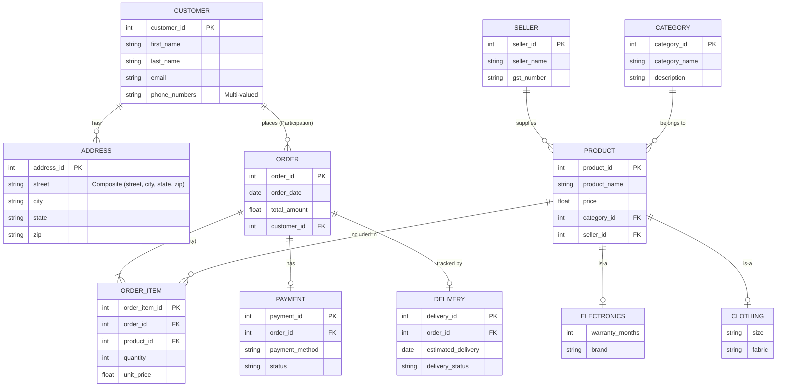

# Experiment 1: ER Diagram for Indian E-commerce Platform

This directory contains the Entity-Relationship (ER) diagram for an Indian e-commerce platform.

## Files
- `ER_Diagram.drawio`: The ER diagram in Draw.io format.
- `requirements.txt`: The initial problem statement.

## ER Diagram (Mermaid Representation)

