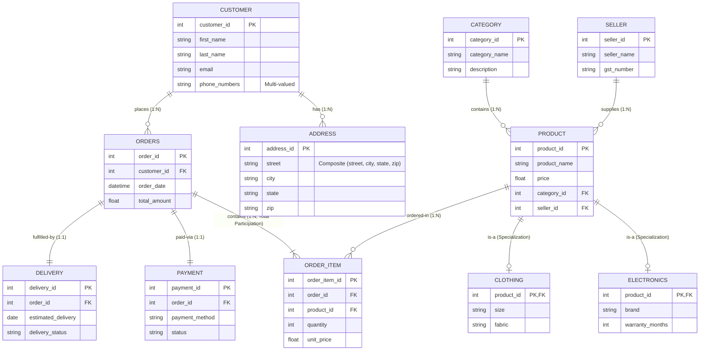

# Experiment 1: ER Diagram for Indian E-commerce Platform

This directory contains the Entity-Relationship (ER) diagram for an Indian e-commerce platform.

## Files
- `ER_Diagram.drawio`: The full ER diagram in Draw.io format.
- `README.md`: Contains the Mermaid visual diagram, entities, and constraint specifications.

## ER Diagram (Mermaid Representation)

## Structural Design Details
- **Primary Keys:** Every strong entity possesses an explicit unique identifier (`customer_id`, `seller_id`, `product_id`, `order_id`, etc.).
- **Composite Attributes:** The customer delivery location contains composite sub-attributes (`street`, `city`, `state`, `zip`).
- **Multi-valued Attributes:** The customer entity supports multiple contact telephone numbers.
- **Weak Entity / Total Participation:** `ORDER_ITEM` is bound to `ORDERS` via total participation (every order must contain at least one order item).
- **Specialization / Generalization:** `PRODUCT` specializes into subclass entities `ELECTRONICS` and `CLOTHING` inheriting the primary key.
